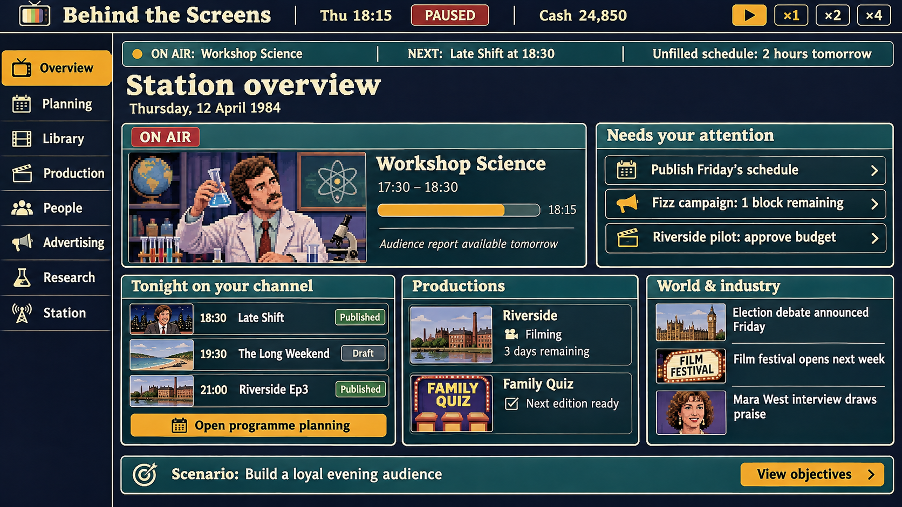
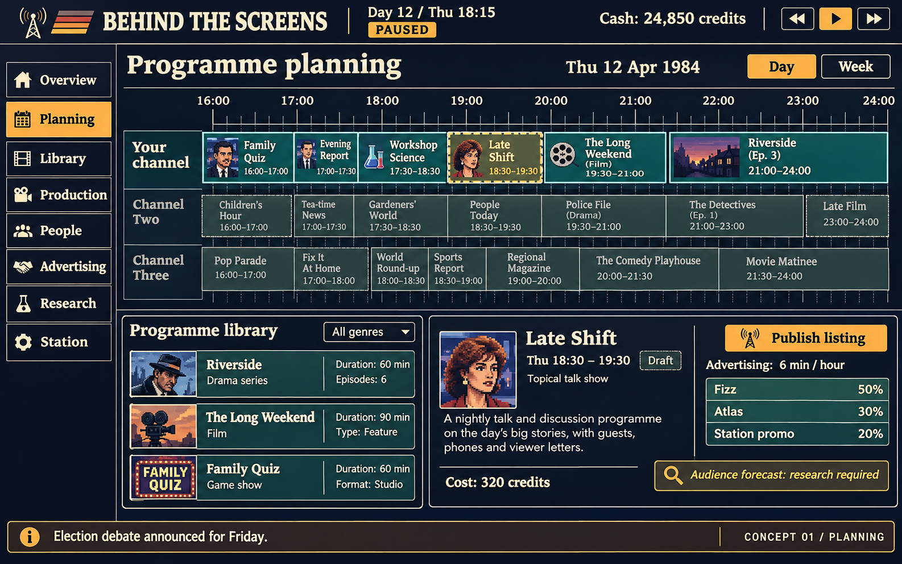
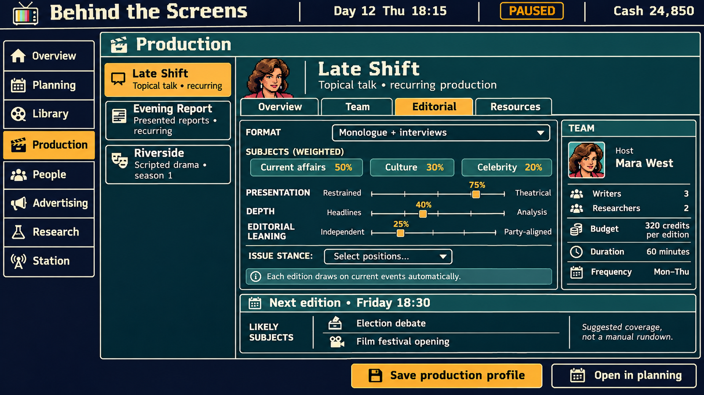

# UI concept mockups

Three generated visual concepts for Behind the Screens, added November 2026.
These are design references, not screenshots of the implemented browser harness.
See [Screens and interaction design](../screens.md) for the proposed workflows.
All programme names, dates, costs, percentages and other values are illustrative.

## Station overview

Current broadcast, upcoming schedule, urgent actions, production progress,
world/industry developments and scenario objectives in one workspace.

## Programme planning

A continuous day timeline with programme durations and competitor lanes,
a programme library, selected broadcast details and advertising shares.
The image shows an evening segment; it does not limit planning to those hours.
Advertising shares describe allocation within ad blocks, rather than individual
spot scheduling. Draft plans and published listings should remain distinct.

## Production: editorial profile

A recurring topical show managed through Production, with format, weighted
subjects, presentation, depth and editorial leaning alongside team and resources.
Current events inform each edition automatically; the likely-subjects preview
is not a required manual news rundown. News bulletins and entertainment-led
current-affairs formats use the same shared production workflow.

## Details to refine

These images explore the 80s television / pixel-art visual direction. Navigation,
labels, control styles and information density are provisional and vary between
concepts. Resolve inconsistencies against the screen design before implementation.
For example, the planning image labels Riverside Ep. 3 as three hours while the
library lists 60-minute episodes, and the Late Shift next-edition date conflicts
with its displayed Mon–Thu frequency. Neither example establishes a game rule.
Audience forecasts require research; unavailable results must stay visibly unknown.

The [implemented planning workspace](../programme-planning.md) now follows the
planning concept's layout and colour direction. The reference still includes
future controls (publication, campaign shares and other workspaces) that are not
implemented. Actual local browser evidence is kept in
[contrib/programme-planning](../../contrib/programme-planning/README.md).
