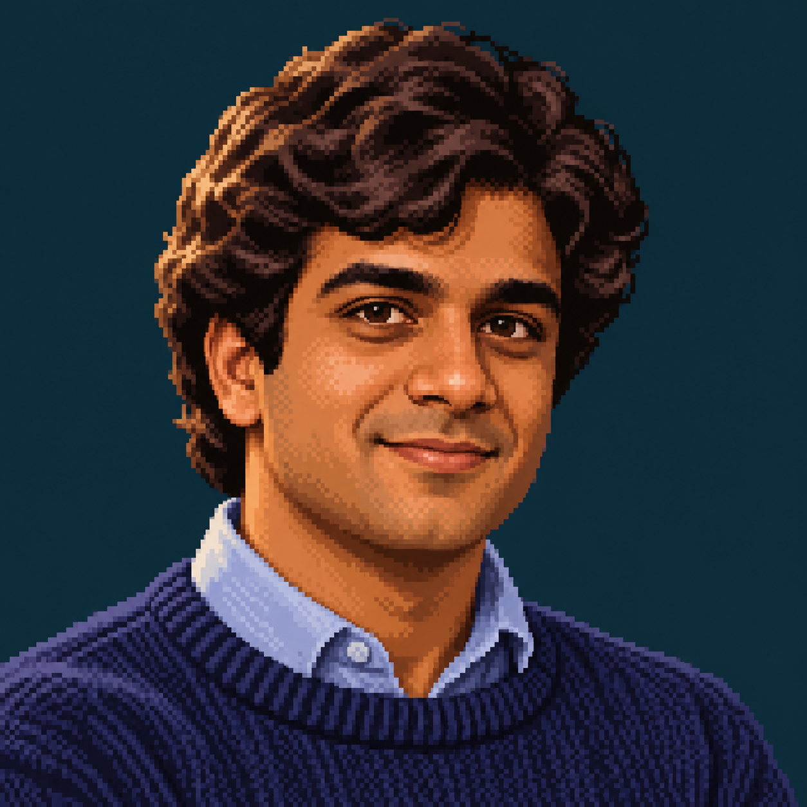
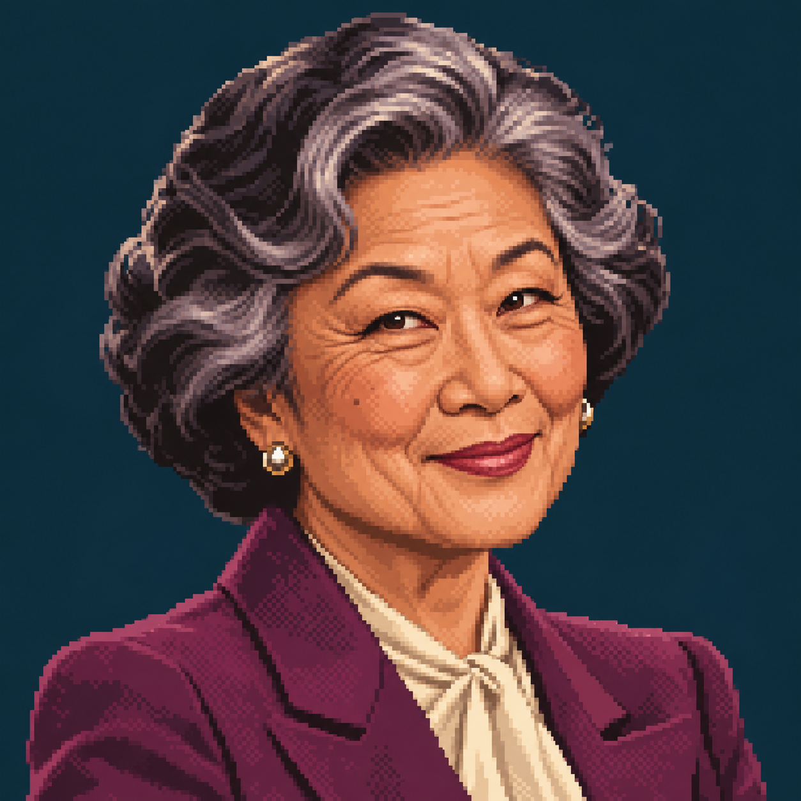

# Fictional character portraits

Initial art set, November 2026: three male and three female fictional adults,
with varied ages, appearances, hairstyles and presentation. These are reusable
portraits for the talent/guest roster, not photographs of real people or actors.
The existing discussion roster uses them in its portrait casting desk.
They can later support the talent market and scripted casting UI.

| Person | Authored gender | Approximate visual age | Current fixture job | Portrait |
| --- | --- | ---: | --- | --- |
| Elian North | Male | 60 | Host |  |
| Mina Sol | Female | 34 | Host |  |
| Nora Vale | Female | 48 | Guest |  |
| Felix Reed | Male | 29 | Guest |  |
| Jules Hart | Female | 64 | Guest |  |
| Rafi Linden | Male | 42 | Guest |  |

Gender and visual ages here are authored art/roster notes, not inferred from the
images or new simulation parameters. Performer gender is distinct from a dramatic
character's gender and any explicit casting requirements. No gender-based skill
modifiers or casting restrictions are implemented. See [talent and contracts](talent-and-contracts.md#performer-gender-and-character-requirements).
The current host/guest assignments are production jobs, not fictional character roles.

Style: head-and-shoulders pixel-art portraits, consistent dark teal studio
backdrops and warm light, restrained period clothing, square composition and
readable faces. Art should identify people without implying that an appearance
reveals talent, morality, temperament or hidden numerical attributes.

Generated with the built-in imagegen tool, one image per person. The complete
[prompt set](portrait-prompts.json) records the shared direction and individual
briefs. Original PNGs are copied into `web/public/portraits/`; no image processing
or external image service is required at runtime. Names/IDs are mapped to artwork
only in the bounded browser fixture. An unfamiliar person gets no unrelated
portrait by fallback. Publication remains disabled and licensing is unchanged.

Validation: TypeScript/static bundle build passed. A real Chromium check switched
through both hosts and all four guests, decoded all six square portraits, verified
accessible image labels and recorded no page errors. The TypeScript language
server was unavailable; `tsc --noEmit` and the browser check supplied feedback.
No Rust simulation or protocol changes were needed.
